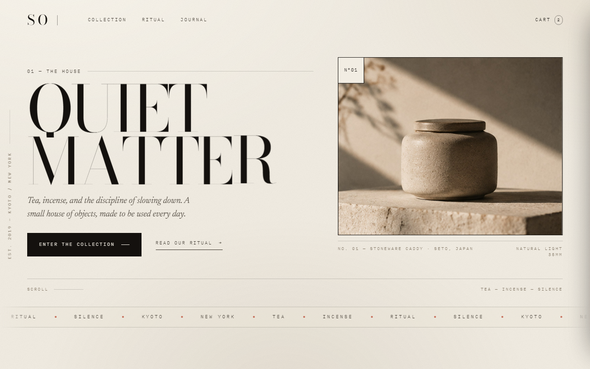

# SO — Tea & Incense House

由效果图 `02-so-editorial.png` 落地的单页站点：纸感、Didone 衬线、朱砂单点、发丝线。全部动效与交互用原生 HTML / CSS / JS 实现，无框架、无外部请求。



## 打开方式

```bash
# 直接双击 index.html 也可以；起个本地服务更稳（字体 / 图片同源）
python -m http.server 4319
# → http://127.0.0.1:4319/
```

## 文件

```
├─ index.html                 样式与脚本全部内联（约 74 KB）
├─ assets/
│  ├─ hero.jpg                从效果图裁切的产品主图（2x）
│  ├─ tea-caddy.jpg · incense.jpg · bowl.jpg
│  └─ fonts/                  Bodoni Moda / Newsreader / IBM Plex Mono（自托管可变字体）
├─ preview-hero.png
├─ preview-full.png
└─ README.md
```

字体自托管，不依赖 Google Fonts（国内网络也可离线打开）。

## 动效与交互清单

**入场**
- 纸面预加载：0 → 100 的等宽计数器 + 朱砂细线，然后整层向上揭开
- 大标题逐字上升（`clip` 行遮罩），图片 `clip-path` 自下而上揭幕并轻微缩放
- 右列、按钮、说明文字按 60–900ms 错峰淡入

**首屏**
- 鼠标靠近标题时，每个字母有 15px 内的磁吸位移（离开即回弹）
- 悬停单个字母转朱砂色
- 照片随滚动做 26px 反向视差；悬停时缓慢推近
- 照片左上角 `N°01` 标签、右上角十字准星、底部说明书式图注

**滚动**
- 顶部细线进度条 + 章节索引（≥1460px 显示）
- 跑马灯速度随滚动方向与速度变化，悬停减速
- 各区块 `IntersectionObserver` 逐段显现，发丝线从左展开
- 段落标题在桌面端粘性停留（ritual 左栏）

**商品**
- 列表行悬停：底色浮起、名称右移 8px、缩略图推近、右上出现 `＋`
- 点击任意一行（或点主图）打开右侧「对象」抽屉：规格表、材料、产地、加入购物袋
- 加入购物袋：朱砂小点沿弧线飞向顶部购物车、计数弹一下、左下角提示条
- 购物袋抽屉：数量增减、移除、小计实时计算、空袋文案

**仪式（招牌交互）**
- 圆形取茶盘：**按住 4 秒**，朱砂环逐渐填满、倒数 00:04 → 00:00，松手即复位
- 完成后文案换成「Pour slowly. Leave the last drop.」，键盘 Space / Enter 同样可用
- `prefers-reduced-motion` 下所有位移 / 视差 / 跑马灯自动关闭

**其它**
- 自定义光标：40px 墨色圆环 + 5px 圆点，外圈带纸色描边（在深色照片上也看得见）；悬停商品放大成 `View` 药丸、悬停按钮变成朱砂实心圆。**系统光标只在自定义光标真正可见时才隐藏**（`body.cursor-active`），所以 JS 失效、触屏、`prefers-reduced-motion` 下都会老老实实显示原生箭头/文本光标。
- 首页 / 纽约当地时间每秒刷新
- 订阅表单做邮箱校验，成功 / 失败走同一条提示
- 移动端：全屏大字菜单、单列重排、抽屉占满宽度

## 可访问性

- 跳转链接、语义化 `main/nav/footer`、抽屉 `role="dialog"` + `aria-modal`
- 打开抽屉时页面主体 `inert`，Esc 关闭，关闭后焦点回到触发元素
- 所有交互元素可键盘触达并有 `:focus-visible` 描边；图片有 alt，装饰元素 `aria-hidden`
- `prefers-reduced-motion` 全量降级

## 素材说明

- 摄影：取自效果图 `02-so-editorial.png` 的裁切（2x LANCZOS + 轻锐化），与页面同一套色温
- 字体：Bodoni Moda、Newsreader、IBM Plex Mono，均为 SIL Open Font License
- 页面为设计研究（design study），没有真实结账、库存或后端
